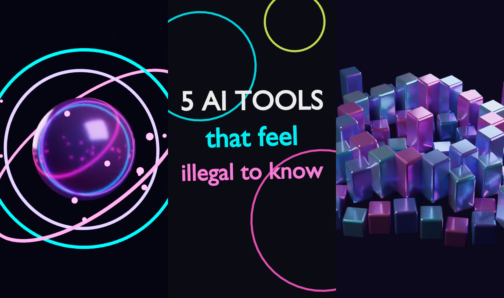

# AI Reels Studio 🎬

Make striking 3D Instagram Reels with **Blender**, driven by **Claude** through the
[Blender MCP](https://github.com/ahujasid/blender-mcp) server. You describe a reel in chat,
Claude builds and animates it in your open Blender, and then one command renders it into an
Instagram-ready MP4.



```
 You ──chat──> Claude ──MCP──> blender-mcp ──socket :9876──> Blender add-on ──> your scene
                                                                   │
              reels/*.json ──> studio/ templates ──> PNG frames ──> postprocess.py ──> reel.mp4 + cover.jpg
```

## What's inside
| Path | What it is |
|---|---|
| `.mcp.json` | Blender MCP server config for **Claude Code** (start `claude` in this folder) |
| `claude_desktop_config.example.json` | The same config for **Claude Desktop** |
| `CLAUDE.md` | Reel rules (9:16, safe zones, hook timing) that Claude follows when building |
| `studio/` | Python library that runs inside Blender: render setup, materials, templates |
| `studio/templates/` | `realistic_brain` (cinematic, Cycles), `holo_brain`, `neon_orb`, `kinetic_title`, `crystal_loop` |
| `studio/text.py` | Kinetic text blocks + a separate overlay pass so text/HUD stays sharp over depth of field |
| `reels/*.json` | Reel specs: template, duration, palette, on-screen text, params |
| `scripts/render_reel.py` | Headless render: spec to PNG frames |
| `scripts/postprocess.py` | ffmpeg: frames to 1080x1920 H.264/AAC MP4 with glow, grain, music and a cover image |
| `prompts/reel_prompts.md` | Ready-to-paste prompts and content-series ideas |

## Setup (on your own computer)
You need **Blender 4.2+** (tested on 5.0), **Python 3.10+**, **[uv](https://docs.astral.sh/uv/)** and **ffmpeg**.

1. **Install the Blender add-on**
   - Download [`addon.py`](https://github.com/ahujasid/blender-mcp/blob/main/addon.py) from the blender-mcp repo.
   - In Blender, go to *Edit > Preferences > Add-ons*, then the dropdown menu > *Install from Disk…*, pick `addon.py` and enable **Blender MCP**.
   - In the 3D viewport, press **N** and open the **BlenderMCP** tab. Optionally tick Poly Haven / Hyper3D / Sketchfab, then click **Connect**.
2. **Connect Claude**
   - *Claude Code:* `cd ai-reels-studio && claude`. The `.mcp.json` here gets picked up (approve it when asked). Check with `/mcp`.
   - *Claude Desktop:* *Settings > Developer > Edit Config* and merge in `claude_desktop_config.example.json`, then restart. A hammer/tools icon shows the Blender tools.
   - Only run **one** MCP client against Blender at a time.
3. **Try it:** *"Build reels/neon_orb.json in Blender and show me a screenshot."*

## Render a reel
```bash
# quick preview (half-res, first 2 s)
blender -b -P scripts/render_reel.py -- reels/kinetic_title.json --draft --frames 1-60

# full quality
blender -b -P scripts/render_reel.py -- reels/kinetic_title.json

# Instagram-ready MP4 + cover (add --loops 2 to double a seamless loop)
python scripts/postprocess.py output/ai_tools_hook --glow --grain --music music/track.mp3
```
Or use `make draft R=kinetic_title` and `make reel R=neon_orb MUSIC=music/track.mp3`.
On a machine without a usable GPU, add `--engine cycles` to the render command.
Templates with on-screen text/HUD (like `realistic_brain`) also render a transparent
`frames_overlay/` pass; `postprocess.py` composites it automatically. Use `--samples N` to trade
quality for speed, and render `realistic_brain` with `--engine cycles` (the brain's crease
shading needs Cycles).

Output is in `output/<name>/`: `<name>_reel.mp4`, `<name>_cover.jpg` and the `.blend` file.

## Render lots of reels fast (cloud GPU)
No GPU at home? Open [`notebooks/render_on_colab.ipynb`](notebooks/render_on_colab.ipynb) in
Google Colab, switch the runtime to GPU, and run all cells. It installs Blender, renders every
spec in `reels/` with `scripts/batch.py`, and copies the MP4s to your Google Drive.

On any machine with Blender:
```bash
python scripts/batch.py "reels/*.json" --engine cycles          # GPU, full quality
python scripts/batch.py "reels/*.json" --engine cycles --fast   # CPU-friendly drafts
```
Finished reels are skipped on re-runs, so you can keep adding specs and re-running.

## Make your own reel
Copy a spec and edit it:
```json
{
  "name": "my_hook",
  "template": "kinetic_title",
  "duration_s": 6,
  "palette": ["#0A0A14", "#00E5FF", "#FF3D9A"],
  "text": ["THIS AI", "built my", "whole website"],
  "params": {"stagger_s": 0.5}
}
```
`palette[0]` is the background colour and the rest are accents. Each template's docstring lists its `params`.
For a brand-new look, ask Claude to build it live through MCP, then to *"turn this into a template"*.

## Posting tips
- Upload the MP4 as-is (don't let your phone re-export it). Use the cover JPG as the reel cover.
- Add trending audio in the Instagram app, or use only music you have the rights to.
- 7-12 s loops with a clear hook tend to get the most replays.
